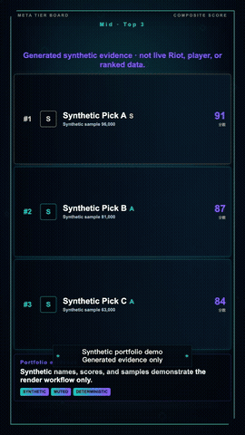
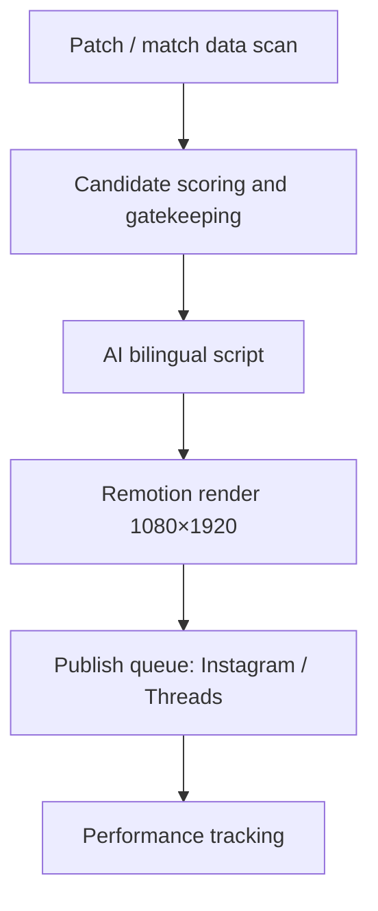
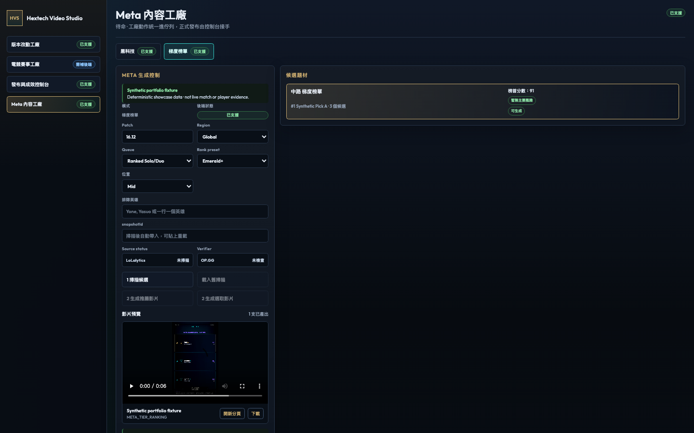

# Hextech Video Studio

[](https://github.com/Hunter20041004/lol-video-generator/actions/workflows/ci.yml)

**Turns League of Legends patch notes and esports match data into bilingual short videos, and posts them to Instagram and Threads automatically.**

把《英雄聯盟》版本改動與電競賽事資料，自動做成中英雙語短影音，並自動發到 Instagram 與 Threads。

> **Type** Personal project · **Status** Completed (2026-04 → 2026-10), archived · **Role** Solo project · **Stack** Next.js, React, Remotion, Node.js, Google Generative AI, Meta Graph API (Instagram / Threads)





<br clear="right">

Committed portfolio evidence: [Watch the muted synthetic MP4](public/demo/meta-tier-ranking.mp4) · [View the workbench PNG](docs/screenshots/workbench.png) · Instagram: [@hextech.vs.cn](https://www.instagram.com/hextech.vs.cn/)

The committed video is generated synthetic evidence, not live Riot, player, or ranked data; it is muted and uses unmistakably synthetic names, scores, and sample values. Local portfolio route: `http://localhost:3000/?portfolio=1`.

## Background

I wanted to see whether a whole esports content channel could run as a pipeline: data comes in after each patch or match, and a finished video goes out to Instagram with as little manual work as possible.

## What it does

- **Four workspaces** in one Next.js workbench: patch changes, esports matches, a meta content factory, and a publishing and performance console.
- **Data to video end to end**: scan the data, score candidates, write Chinese and English scripts with AI, render vertical videos with Remotion.
- **Posts automatically** to Instagram and Threads through the Meta Graph API, with OAuth account linking, a publish queue and performance tracking.
- **Blocks bad posts**: publishing stops if assets are incomplete, a data source is degraded, or the video file is missing.



## Key decisions

| Decision | Why |
| --- | --- |
| Publishing gates instead of "render and post" | A wrong stat or missing asset on a public account is worse than a late post. |
| Player-radar videos can't publish without evidence for each stat | A public account shouldn't post player numbers that can't be traced back to the match data. |
| Account linking checks the expected username before posting | Prevents posting to the wrong Instagram or Threads account. |
| Local, re-runnable data layer (snapshots, queue, insight store) | A failed render or post can be retried without losing state. |

## Results

- Ran the Chinese Instagram account [@hextech.vs.cn](https://www.instagram.com/hextech.vs.cn/) from 2026-05-22 to 2026-07-10: **90 videos posted by the pipeline, 26,451 total views** (top video 1,777; median 174), 126 followers with zero paid promotion. (Numbers read from the Instagram Graph API on 2026-11-01.)
- The same posts went to Threads in parallel; English Instagram and Threads accounts were also tested. Only the Chinese Instagram account is kept as the public record.
- 250+ commits, 700 automated tests (unit, API boundary, render and opt-in live contract tests) and CI on pushes to main and pull requests.

## Run it locally

```bash
npm ci
cp .env.example .env.local
npm run dev
```

Open `http://localhost:3000`. The workbench and tests run without third-party keys; AI analysis, social login and publishing need your own credentials. To regenerate the portfolio evidence:

```bash
npx playwright install chromium
npm run portfolio:render     # synthetic 180-frame 1080×1920 MP4
npm run dev                  # in one terminal
npm run portfolio:capture    # in another: 1440×900 workbench PNG
```

Architecture, verification, and security and publishing boundaries: [`docs/SETUP.md`](docs/SETUP.md) (Chinese). Publishing setup: [`docs/publishing-setup.md`](docs/publishing-setup.md).

## Notes

Unofficial portfolio project, not affiliated with or endorsed by Riot Games. League of Legends and related marks belong to their owners; check the terms of data sources, game assets and social platforms before reuse.

**Bundled licensed audio.** The MP3 tracks were confirmed by the owner as authorized for generated videos and redistribution in this repository. They remain third-party material outside the ISC license; see [THIRD_PARTY_ASSETS.md](THIRD_PARTY_ASSETS.md).

## 中文摘要

想試試看一個電競內容頻道能不能整條自動化：每次改版或比賽後資料進來，產出雙語短影片並自動發到 Instagram。工作台整合版本改動、電競賽事、Meta 內容工廠與發布成效四個工作區；影片由 Remotion 算圖，透過 Meta Graph API 自動發到 Instagram／Threads，素材不完整或資料來源降級時會擋下發布。2026-05-22 至 07-10 由產線自動發布 90 支影片到 IG @hextech.vs.cn，總觀看 26,451 次、126 位粉絲（未投廣告）。專案已完成並封存。

## License

ISC covers only software and documentation authored by Hunter Tseng（曾尉庭）. Riot trademarks and data, and all other third-party assets and materials, remain under their respective terms.
